# Pair 4 explained visually

Pair 4 searches for useful **Clifford encoder circuits**: ordered sequences of
H, S, and CNOT gates. It proposes circuits, asks an evaluator how good they are,
and decides which ones to retain or explore next.

This guide explains the implementation in this folder. Diagrams labeled
**future integration** describe the intended connection to the other pairs;
that physics pipeline is not implemented inside Pair 4.

> **Current status:** generation, mutation, both searches, exports, and
> benchmarking work. The bundled evaluator measures similarity to a fixed gate
> sequence. Its scores are synthetic and have no quantum-performance meaning.
> Real code-quality experiments await the other pairs' interfaces.

Mermaid diagrams render in Markdown viewers with Mermaid support, including
GitHub. If you see diagram source instead, open a Mermaid-capable preview.

## Reading map

- [1. The whole project](#1-the-whole-project)
- [2. What a candidate contains](#2-what-a-candidate-contains)
- [3. How a circuit specifies a code](#3-how-a-circuit-specifies-a-code)
- [4. Random generation](#4-random-generation)
- [5. The three mutations](#5-the-three-mutations)
- [6. Random search](#6-random-search)
- [7. Evolutionary search](#7-evolutionary-search)
- [8. How ranking works](#8-how-ranking-works)
- [9. Parent, best result, archive, and history](#9-parent-best-result-archive-and-history)
- [10. What the evaluator measures](#10-what-the-evaluator-measures)
- [11. The evaluator connection](#11-the-evaluator-connection)
- [12. Reproducibility](#12-reproducibility)
- [13. Fair benchmarking](#13-fair-benchmarking)
- [14. Output files](#14-output-files)
- [15. Failures and safeguards](#15-failures-and-safeguards)
- [16. Where the code lives](#16-where-the-code-lives)
- [17. Try it yourself](#17-try-it-yourself)
- [18. Tests, limitations, and next steps](#18-tests-limitations-and-next-steps)

## 1. The whole project

Pair 4 asks, **“Which circuit should we try next?”** The other pairs provide the
tools that interpret and evaluate those circuits.

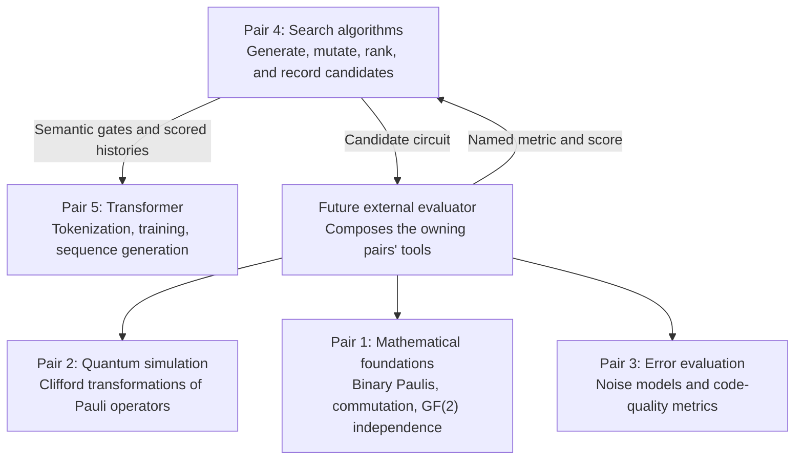

This shows ownership, not a claim that the connections already exist. Pair 4's
production code imports no Stim, NumPy, JAX, or PyTorch. It consumes an evaluator
interface instead of implementing another pair's subsystem.

## 2. What a candidate contains

A **candidate** is one proposed encoder:

| Field | Meaning | Example |
| --- | --- | --- |
| `n_qubits` | Number of physical qubits | `4` |
| `k_logical` | Number of logical qubits to encode | `2` |
| `gates` | Instructions in chronological application order | H, then CNOT, then S |

Physical qubits are individual wires; logical qubits are the encoded information.
Code notation `[[n,k]]` records those numbers. When distance is known, it adds
a third number: `[[n,k,d]]`. [Gottesman, §3.2](https://arxiv.org/html/quant-ph/9705052v1)

A complete exported candidate looks like this:

```json
{
  "schema_version": 1,
  "n_qubits": 4,
  "k_logical": 2,
  "gates": [
    {"op": "H", "qubits": [0]},
    {"op": "CNOT", "qubits": [0, 2]},
    {"op": "S", "qubits": [1]}
  ]
}
```

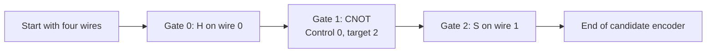

This illustrates **application order**, not a quantum circuit drawing with one
horizontal line per qubit. Indices start at zero. CNOT operands always mean
`(control, target)`. The register has four wires even though wire 3 is unused.

An empty sequence retains its register size and represents the identity encoder.
The Python records are immutable: a mutation creates a child without changing
its parent.

## 3. How a circuit specifies a code

Our convention puts the `n-k` ancillas, initialized to zero, first. The last `k`
wires hold arbitrary logical inputs. For `n=4, k=2`:

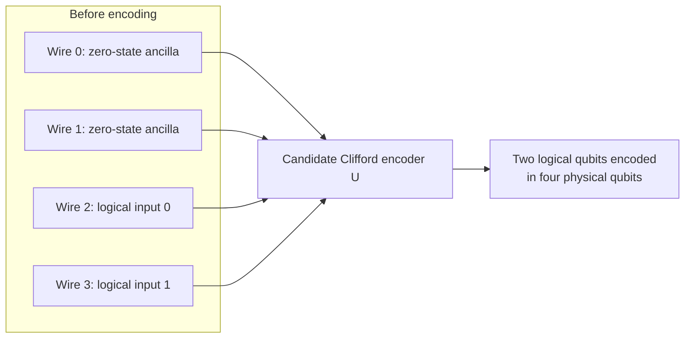

A stabilizer generator specifies a codespace constraint. The ancillas initially
give `+ZIII` and `+IZII`. Pair 2 will conjugate each check through the circuit:
`P → U P U†`. This preserves commutation and independence; signs must be retained.
Exactly `n-k` independent checks leave a space of dimension `2^k`. Using all
`n` checks of an all-zero state would instead select one stabilizer state.
[Gottesman, Chapters 3–4](https://arxiv.org/html/quant-ph/9705052v1)

Thus legal candidates preserve a valid code description under this convention.
They can still have poor protection. Pair 4 proposes circuits; the external
tools determine their mathematical description and quality.

## 4. Random generation

Generation chooses a length, then chooses each instruction:

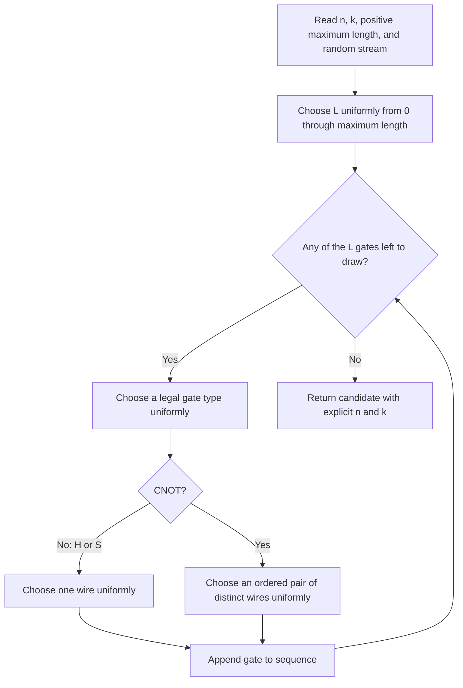

The default maximum length is `8*n`. Four physical qubits therefore allow
starting lengths from 0 to 32: 33 equally likely lengths.

For `n >= 2`, H, S, and CNOT each have probability `1/3`. For `n=1`, only H and S
are available, each with probability `1/2`.

### Why choose the gate type first?

On four wires there are four H instructions, four S instructions, and twelve
directed CNOT instructions. Uniformly sampling all twenty instructions would
give CNOT probability `12/20 = 60%`. Choosing the type first keeps it at `1/3`.

This is a deliberate distribution. It does **not** uniformly sample Clifford
transformations or stabilizer codes. Different sequences can describe the same
transformation or code.

### How are distinct CNOT operands guaranteed?

The sampler picks a control, then selects among the other `n-1` wires. With
`n=5` and control 2, possible targets are `0, 1, 3, 4`. It maps a draw from
`0 ... n-2` onto that list by skipping the control index. No retry is necessary.

## 5. The three mutations

Mutation changes a candidate's description by one edit:

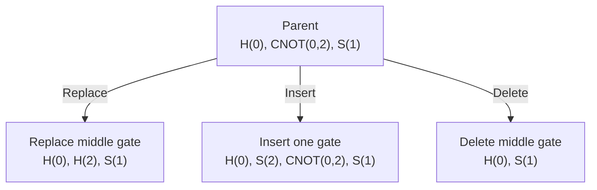

- **Replace:** choose an existing position and a different legal instruction.
  Changing operands counts: `H(0)` can become `H(2)`.
- **Insert:** choose uniformly among all `L+1` gaps, including both endpoints.
- **Delete:** choose uniformly among the `L` existing gates.

The parent remains unchanged. Replacement uses a finite weighted set rather than
retrying until it draws something different. Its weights preserve the original
gate distribution conditioned on excluding the old instruction.

### Boundary rules

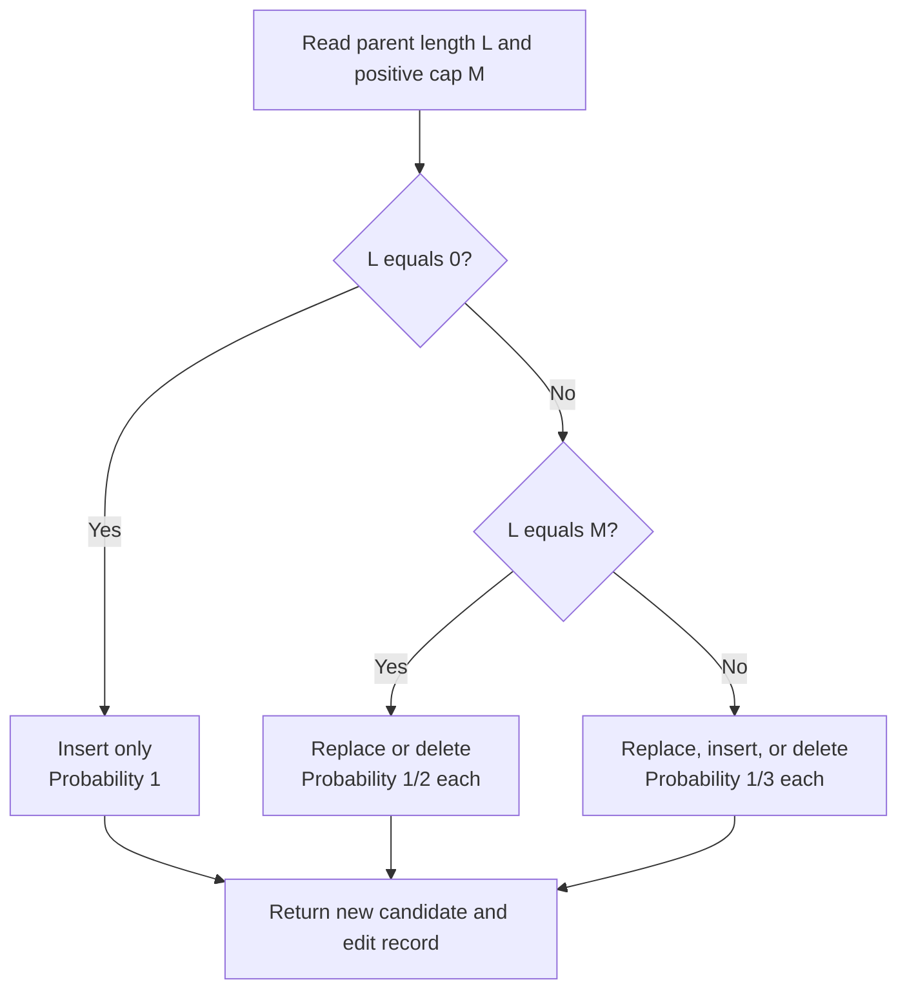

Length stays between zero and the cap. Configuration rejects a zero cap.
Equal interior insertion/deletion probabilities do not make the walk over codes
unbiased: boundaries, selection, and redundant encoders still influence it.

## 6. Random search

Random search asks, **“What happens if we keep trying fresh circuits?”** Scores
determine what is remembered, but do not guide the next draw.

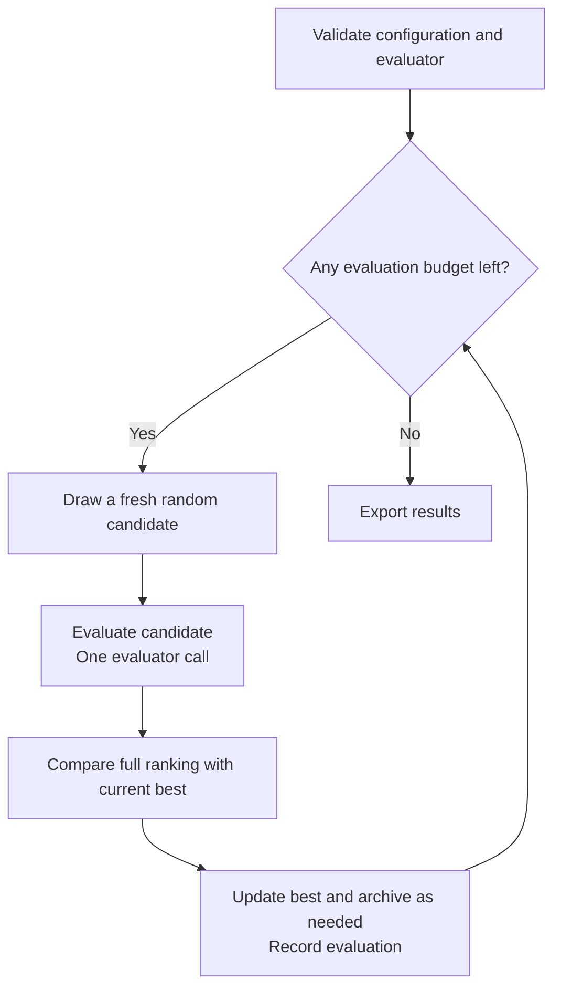

The first draw uses the `initial` stream. Later draws use `proposals`. This
diagram assumes evaluation succeeds; failures are covered in section 15.

This baseline lets us test whether building on previous candidates actually
helps compared with independent sampling.

## 7. Evolutionary search

The implemented method is called **`(1+1)`**: one current parent is compared with
one proposed child at each selection step.

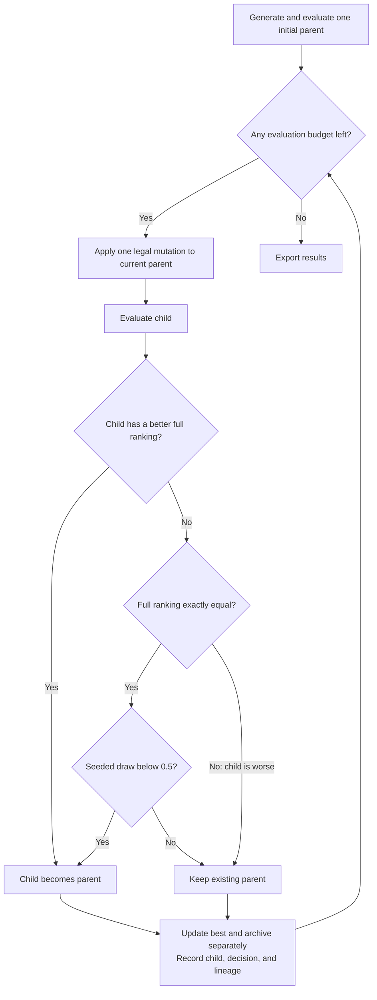

Future mutations build on the accepted parent. Occasionally accepting an equally
ranked child permits movement across a **plateau**, where different candidates
have the same ranking. Equality includes structural costs, not just the score.

This is a mutation-only baseline with no population, crossover, or automatic
restart. It can get stuck. Gate-sequence evolution has published precedent, but
this small loop is our project choice rather than a reproduction of that paper's
algorithm. [Tandeitnik and Guerreiro, §II.2](https://arxiv.org/html/2210.05058v1#S2.SS2)

## 8. How ranking works

Both methods apply the same ordering:

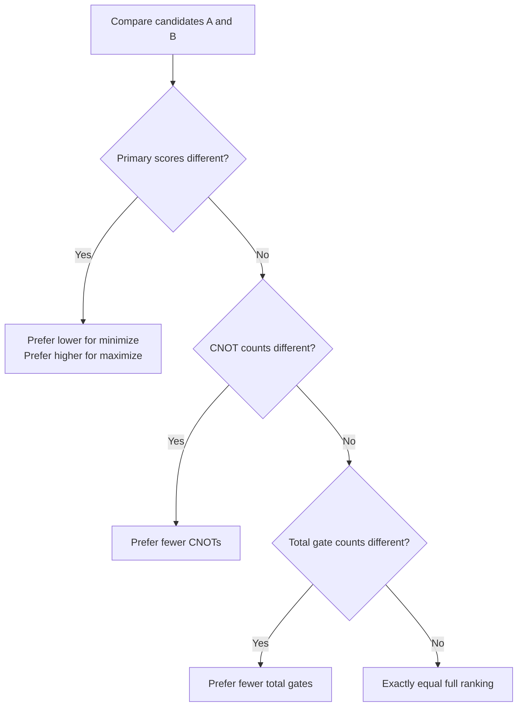

For a probability to minimize, consider these **illustrative**, unmeasured scores:

| Candidate | Probability | CNOTs | Total gates | Result |
| --- | --- | --- | --- | --- |
| A | 0.020 | 1 | 4 | Loses to B on probability |
| B | 0.019 | 12 | 20 | Beats A despite its larger circuit |
| C | 0.019 | 9 | 30 | Beats B on CNOT count |
| D | 0.019 | 9 | 25 | Beats C on total gate count |

This is **lexicographic** ordering: later criteria matter only when earlier ones
are exactly equal. Scores are not rounded; no weighted penalty lets gate savings
outweigh worse protection.

Internally, smaller ranking tuples always win:

```text
Minimize: ( value, CNOT count, total gate count)
Maximize: (-value, CNOT count, total gate count)
```

## 9. Parent, best result, archive, and history

These are different records:

| Record | Question it answers |
| --- | --- |
| Current parent | Where does the next evolutionary mutation start? |
| Best result | What is the best-ranked candidate observed? |
| Archive | What are the ten best distinct gate sequences retained? |
| History | What happened on every evaluation? |

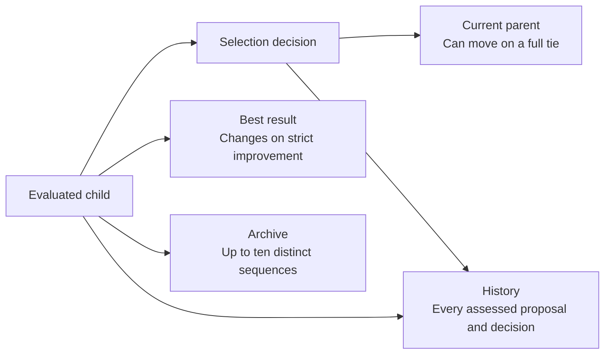

After a neutral move from A to B, B can become the parent while A remains the
recorded best: their ranks are equal, so no strict improvement occurred.

A rejected child can still enter the archive if it ranks among the retained top
ten. Deduplication compares exact candidate sequences, not equivalent codes.
The archive is **not a cache**: drawing the same circuit again still consumes
a call and produces another history record.

## 10. What the evaluator measures

### The current demo

For multiple qubits, the fixed target sequence is:

```text
H(0), CNOT(0,1), S(1), H(1), CNOT(1,0), S(0)
```

The demo score is negative **Levenshtein edit distance** to this target. Each full
gate instruction is one item; it compares gates, not characters. An insertion,
deletion, or replacement costs one edit.

| Candidate | Distance | Demo score |
| --- | --- | --- |
| Exact target | 0 | 0 |
| Target plus one extra gate | 1 | -1 |
| Empty sequence | 6 | -6 |

The demo maximizes the score; `0` is optimal. One-qubit diagnostics use a separate
six-gate H/S-only target. A cap below six makes the full target unreachable, which
is allowed: successful execution does not require finding it.

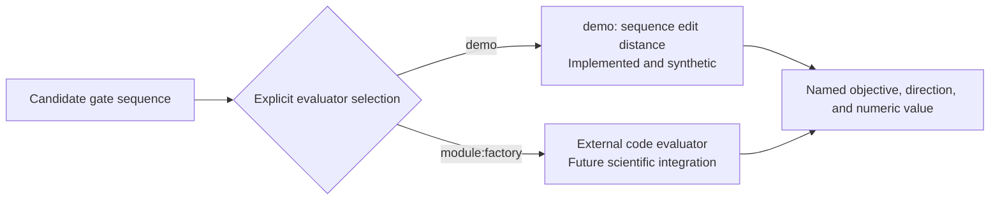

### The future scientific objective

We selected **harmful undetected-error probability**. This conceptual
classification belongs in the external evaluator:

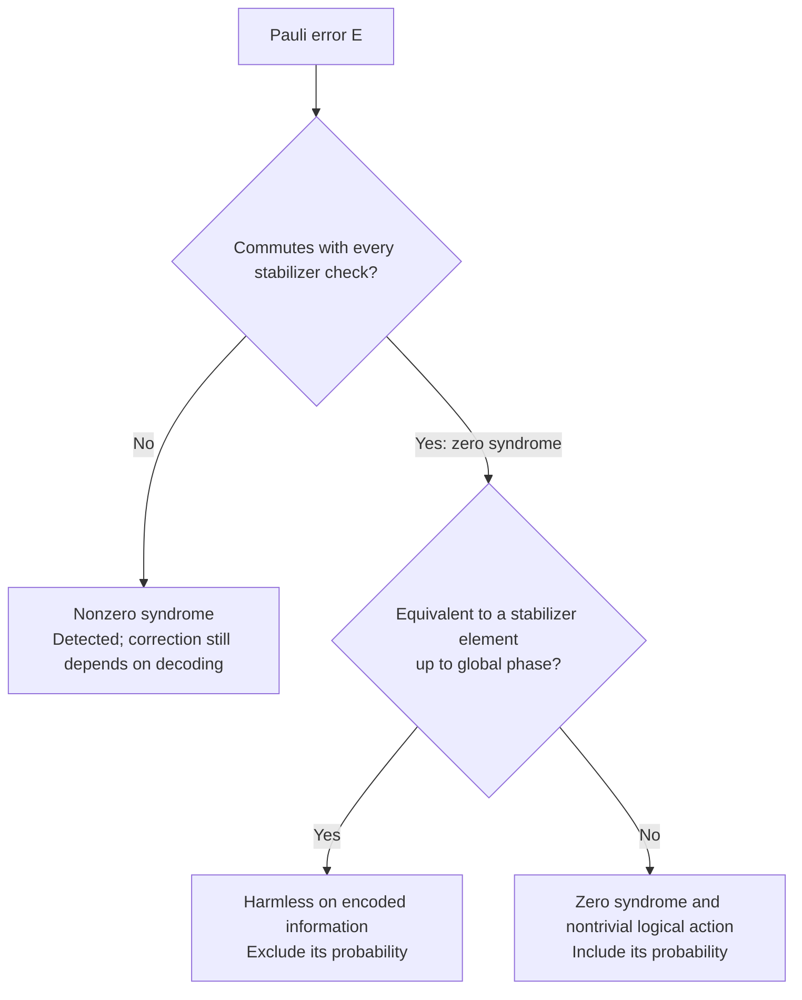

Ignoring overall error phase, the objective sums `p(E)` over Pauli operators
commuting with every check but outside the stabilizer group. Identity and
nonidentity stabilizer errors are excluded. This is decoder-independent; it
does not measure the outcome of recovering from detected errors.
[Webster and Browne, §II-C](https://arxiv.org/pdf/2409.13017)

| Metric | Question | Better direction |
| --- | --- | --- |
| Distance | What is the smallest weight of a harmful undetected Pauli? | Higher |
| Harmful undetected probability | How likely are harmful errors that escape detection under a specified noise model? | Lower |
| Decoder-dependent logical failure | How likely is incorrect logical information after a specified recovery? | Lower |

Weight counts affected physical qubits. Detection alone does not establish
correction. These distinctions follow the stabilizer error classification.
[Gottesman, §3.2](https://arxiv.org/html/quant-ph/9705052v1)

Pair 4 consumes the chosen metric without computing quantum errors. The demo's
instruction edit distance is entirely separate from quantum-code distance.

## 11. The evaluator connection

An **interface** is an agreement on inputs and outputs. An evaluator exposes
`objective` and `evaluate(candidate)`:

| Record | Contents |
| --- | --- |
| `ObjectiveSpec` | Metric name, direction, version, parameters, exactness, synthetic flag |
| `EvaluationResult` | Finite numeric value and optional diagnostics |

Objective metadata must stay fixed within a run and across a benchmark. Changing
noise settings midway would make scores incomparable, so metadata changes cause
an explicit failure. Version 1 requires an exact, deterministic evaluator. Here
“exact” describes the evaluation method, not arbitrary-precision arithmetic:
results are Python floats.

The next diagram is **future integration**, not implemented orchestration. The
external provider composes the owning pairs' actual APIs:

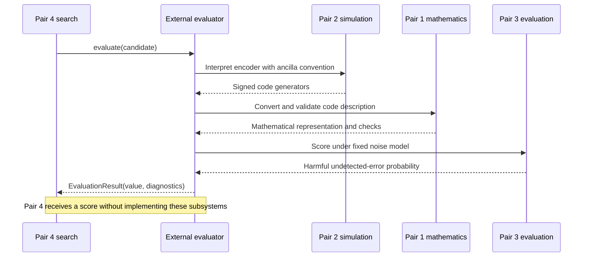

For the CLI, `module:factory` means “import this module and call this factory
function.” The function receives a configuration dictionary and returns a fresh
evaluator instance. Each benchmark run gets its own instance.

The proposed experiment uses `(n,k)=(4,2)`, then `(5,1)`, depolarizing data noise
with `p=0.01` after encoding, and ideal syndrome information.
[examples/depolarizing.json](examples/depolarizing.json) records that request;
an external factory still needs to interpret it and report its effective settings.

## 12. Reproducibility

A **seed** makes random choices repeatable in a pinned software environment.
We separate different kinds of choices into named streams:

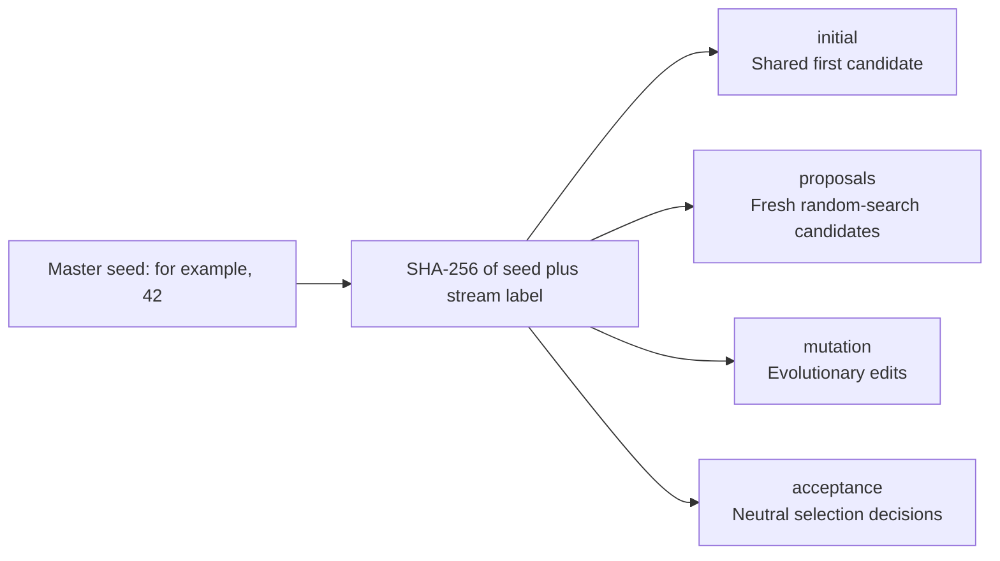

Each uses `random.Random`, initialized from the big-endian integer SHA-256 digest
of UTF-8 `pair4:v1:<seed>:<label>`. Advancing one stream does not advance another.

Both methods can therefore share their first circuit while proposing subsequent
circuits differently. The manifest records Python and configuration; the history
records every assessed circuit. Pin Python for byte-for-byte replay of histories
and manifests. Timing and output directory names vary normally.

## 13. Fair benchmarking

The question is: **With the same evaluation budget, does building on the current
parent help?**

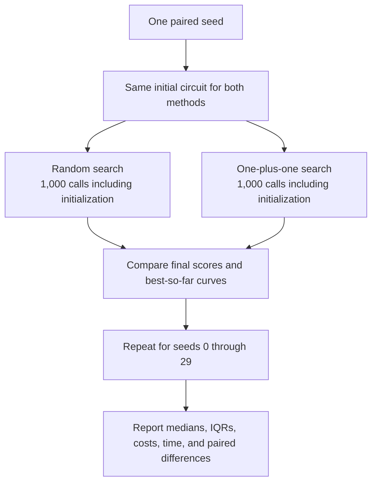

The default successful comparison performs:

```text
30 seeds × 2 methods × 1,000 calls = 60,000 evaluator calls
```

Initialization, repeated candidates, and failed evaluator calls all consume
budget. A failed run stops that benchmark. Counting calls is clearer than
counting generations, whose costs can differ between algorithms.

| Reported quantity | Meaning |
| --- | --- |
| Best-so-far curve | Best primary score reached at each call count |
| Median | Middle outcome across seeds |
| Interquartile range, or IQR | Range from the 25th to 75th percentile |
| Structural costs | CNOT and total gate counts of selected best candidates |
| Timing | Measured separately; equal call counts can take different time |
| Paired differences | Evolutionary result compared with random result for each seed |

A positive `evolution_advantage` always favors evolution. It is
`random_score - evolutionary_score` for minimization and the opposite difference
for maximization. Only **complete seed pairs** enter comparison statistics.

Use separate pilot/tuning seeds before freezing final settings. Synthetic demo
results cannot establish better QEC performance, even if evolution wins.

## 14. Output files

Every assessed proposal creates a history record, including duplicates,
rejections, and evaluator failures. It stores the candidate, result when
available, parent evaluation index, edit, acceptance, and best primary value.

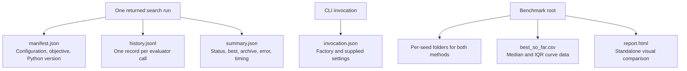

**JSONL** means one JSON object per line. Evaluation indices start at 1. A child's
`parent_index` points to the accepted candidate from which it was mutated;
that need not be the immediately preceding evaluation.

Search commands put `invocation.json` inside their run folder. Benchmarks put it
at the benchmark root, with benchmark-level manifest and summary files; per-seed
folders contain the individual run files.

These semantic gate lists can be handed to Pair 5. Token IDs, special tokens,
padding, tensors, and training-example design remain Pair 5's responsibility.

## 15. Failures and safeguards

Failure is recorded explicitly, rather than assigned a fabricated numeric score.

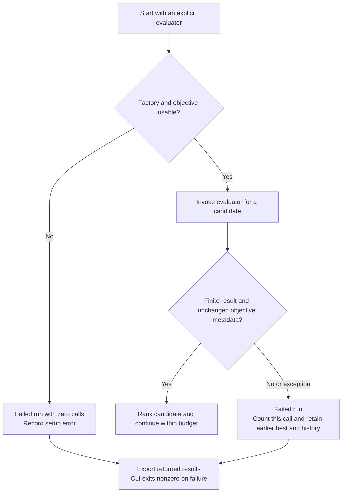

Configuration rejects invalid dimensions, nonpositive caps/budgets, invalid gate
operands, and conflicting CLI/evaluator dimensions. Scientific search requires
`1 <= k < n`; diagnostic candidates and synthetic demos can use `k=0` or `k=n`.

Missing providers never silently select the demo. Existing output locations are
not overwritten. A benchmark stops on its first failed run and retains earlier
outputs.

**Checkpoint limitation:** histories are exported when a run returns, including
after evaluator exceptions. Abrupt termination or power loss during an individual
run is not checkpointed continuously.

## 16. Where the code lives

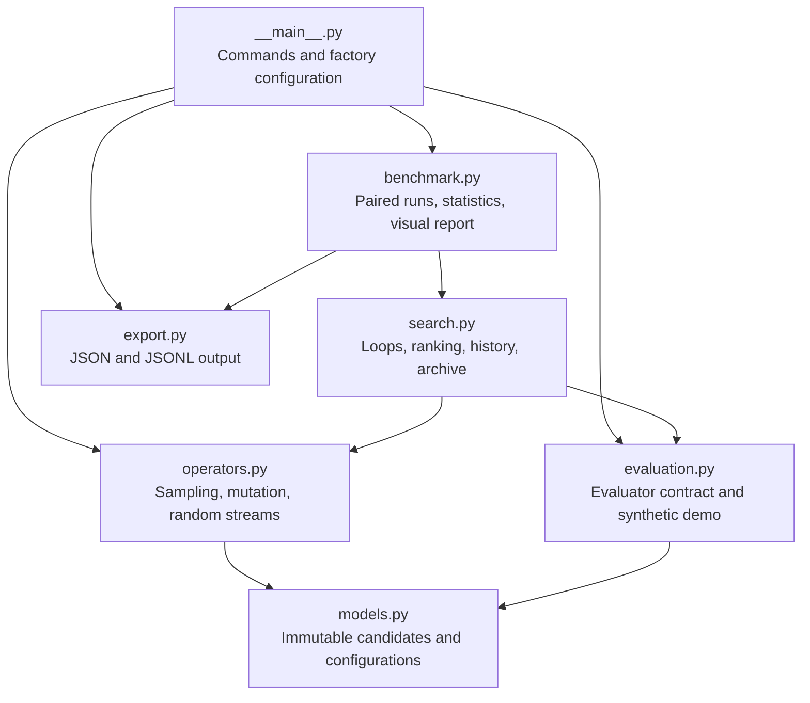

Arrows show main use relationships, not an exhaustive import graph.

| File | Start here when asking… |
| --- | --- |
| [models.py](models.py) | What is a candidate, configuration, or edit record? |
| [operators.py](operators.py) | How are gates selected and mutated? |
| [evaluation.py](evaluation.py) | What does evaluation return, and how does the demo score? |
| [search.py](search.py) | How does selection work, and what is retained? |
| [benchmark.py](benchmark.py) | How are methods compared and reports generated? |
| [export.py](export.py) | How are results written? |
| [CLI module](__main__.py) | How are command-line arguments interpreted? |
| [Package exports](__init__.py) | What can be imported directly from `pair4`? |
| [README.md](README.md) | What is the compact usage and integration reference? |

## 17. Try it yourself

Run from the repository root with Python 3.10 or newer. Pair 4 needs no
third-party dependencies.

**Inspect generated gate lists:**

```bash
python3 -m pair4 sample --n 4 --k 2 --seed 42 --count 2
```

This prints JSON; generation alone does not assess code quality.

**Run evolutionary search with synthetic scores:**

```bash
python3 -m pair4 search --method one_plus_one --evaluator demo --seed 42 --budget 100
```

Read `summary.json` for the best candidate and `history.jsonl` for the decisions.

**Run the baseline with the same initial candidate:**

```bash
python3 -m pair4 search --method random --evaluator demo --seed 42 --budget 100
```

**Generate a small visual comparison:**

```bash
python3 -m pair4 benchmark --evaluator demo --budget 100 --seeds 1000 1001
```

Open the printed `report.html` path in a browser. It contains synthetic labels,
primary-objective curves, IQR bands, and final-score and cost summaries.

**Run the default 30-seed comparison:**

```bash
python3 -m pair4 benchmark --evaluator demo
```

Output directories are created under `pair4/runs/` and ignored by Git.

**Future real-evaluator invocation:**

```bash
python3 -m pair4 benchmark --n 4 --k 2 --evaluator team_evaluator:make \
  --evaluator-config pair4/examples/depolarizing.json
```

`team_evaluator:make` is a **placeholder**, usable only once the team supplies
that module and factory. Until then it fails explicitly. The demo does not
accept `--evaluator-config`, preventing scientific-looking settings from being
silently ignored by a synthetic evaluator.

## 18. Tests, limitations, and next steps

The automated suite checks the machinery:

| Area | Examples |
| --- | --- |
| Candidate validity | Names, arity, wire ranges, distinct CNOT endpoints |
| Generation | Type/operand distributions, one-qubit behavior, length bounds |
| Mutation | End-gap insertion, deletion positions, distinct replacements, unchanged parents |
| Selection | Score priority, structural ties, neutral movement, monotonic best-so-far |
| Reproducibility | Same seeds reproduce histories despite unrelated intervening runs |
| Budgets/failures | Exact counts, partial best retention, nonfinite result rejection |
| Integration boundary | External factory loading and consistent objective metadata |
| Reporting | Exports, paired starts, quartiles, complete-pair statistics |

```bash
python3 -m unittest discover -s pair4/tests -v
```

These checks do not establish quantum-code performance. Pending scientific
integration checks include signed conjugation, exactly `n-k` independent checks,
harmless-versus-logical error classification, and trusted `[[4,2,2]]` and
`[[5,1,3]]` reference fixtures.

Length bounds limit accessible encoders, equivalent circuits can be evaluated
repeatedly, and a one-parent method can get stuck. Discovering the best possible
code or beating random search is not guaranteed.

When a real evaluator becomes available, the next experiment is a fixed-budget
comparison under the chosen noise model. Populations, crossover, circuit
simplification, hardware constraints, sampled scoring, decoder optimization,
and transformer-guided proposals remain later extensions.

### Research references

- [Original Pair 4 notes](../research.searchalgorithms.md)
- [Perplexity research](../perplexity_research.md)
- [Gemini research](../gemini_research.md)
- [Gottesman: Stabilizer Codes and Quantum Error Correction](https://arxiv.org/html/quant-ph/9705052v1)
- [Tandeitnik and Guerreiro: Evolving Quantum Circuits](https://arxiv.org/html/2210.05058v1)
- [Webster and Browne: Engineering Quantum Error Correction Codes Using Evolutionary Algorithms](https://arxiv.org/abs/2409.13017)

The implementation is the source of truth for current behavior. Values such as
`8*n`, equal legal mutation weights, the tie-breakers, and 30 paired seeds are
project defaults rather than proven optimal parameters.
